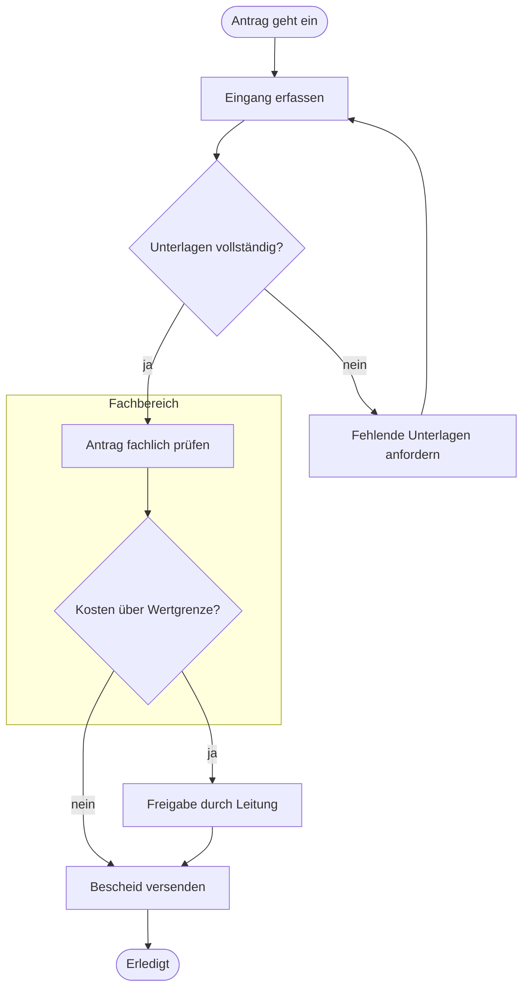

# Ablaufdiagramm erstellen

## Was entsteht

Eine Markdown-Notiz mit einem Flussdiagramm als Mermaid-Codeblock. Die App
zeichnet das Diagramm im Lesen-Modus; im Markdown-Modus bleibt es Text, den
man jederzeit ändern kann. Unter dem Diagramm steht derselbe Ablauf als
nummerierte Liste — für den Ausdruck, für Screenreader und falls ein Diagramm
einmal nicht gezeichnet werden kann.

Erzeugt wird die Notiz mit `write_note`. Nicht als Word-, PowerPoint- oder
HTML-Datei: Dort wird Mermaid nicht gezeichnet.

## Wann anwenden

Wenn ein Ablauf mit einer klaren Reihenfolge gezeigt werden soll: ein
Antrags- oder Genehmigungsweg, eine Beschaffung, das Vorgehen bei einer
Störung, ein Aufnahme- oder Einarbeitungsprozess, eine Entscheidungshilfe
(„Was tun, wenn …?“).

Nicht für Themenüberblicke ohne Reihenfolge (dafür die Mindmap) und nicht für
Termine und Zeiträume (dafür den Zeitstrahl).

## Schritt 1: Inhalt beschaffen

- Geht es um eine Notiz, eine Regelung oder einen Anhang, lies zuerst die
  Quelle. Das Diagramm zeigt den Ablauf, der dort steht — es erfindet keine
  Schritte, Fristen oder Zuständigkeiten dazu.
- Fehlt etwas Wesentliches (etwa wer entscheidet), lass es offen und nenne die
  Lücke in der Abschlussnachricht.

## Schritt 2: Ablauf planen

- **Ein Start, mindestens ein Ende.** Jeder Weg führt zu einem Ende.
- **Schritte**: Tätigkeiten im Infinitiv oder als Substantiv („Antrag prüfen“,
  „Freigabe durch Leitung“). Höchstens 50 Zeichen je Knoten.
- **Entscheidungen**: als Frage mit genau zwei oder drei Ausgängen, die
  Ausgänge beschriftet („ja“ / „nein“).
- **Umfang**: 5 bis 15 Knoten. Wird es mehr, teile in einen Hauptablauf und
  einen zweiten Ablauf für den Sonderfall — zwei kleine Diagramme in derselben
  Notiz sind besser lesbar als ein großes.
- **Zuständigkeiten** (optional): Stehen mehrere Beteiligte in der Quelle,
  fasse ihre Schritte in Gruppen (`subgraph`) zusammen, eine je Beteiligtem.
  Höchstens vier Gruppen.
- **Richtung**: `flowchart TD` (von oben nach unten) als Standard. `LR` (von
  links nach rechts) nur bei höchstens sechs Schritten ohne Verzweigung.

## Schritt 3: Mermaid schreiben — diese Regeln verhindern Zeichenfehler

Ein Fehler im Codeblock zeigt statt des Diagramms nur eine Fehlermeldung, und
du siehst das Ergebnis nicht. Halte dich deshalb genau an diese Form:

- Knoten-IDs nur aus Buchstaben und Ziffern: `S1`, `S2`, `E1`. Keine Umlaute,
  keine Leerzeichen in IDs.
- **Jede Beschriftung in doppelten Anführungszeichen**: `S1["Antrag prüfen"]`.
  Dann sind Umlaute, Klammern, Kommas und Bindestriche sicher.
- Formen — nur diese vier:
  - Schritt: `S1["Antrag prüfen"]`
  - Entscheidung: `E1{"Unterlagen vollständig?"}`
  - Start und Ende: `A(["Start"])`, `Z(["Erledigt"])`
  - Dokument oder Ablage: `D1[("Akte")]` nur, wenn die Quelle eine Ablage nennt
- Kanten: `S1 --> S2`, beschriftet `E1 -->|ja| S3`. Kantentext ohne
  Anführungszeichen, kurz, ohne Sonderzeichen.
- **Verboten** in Beschriftungen: doppelte Anführungszeichen, `<`, `>`, `&`
  (schreibe „und“), `#`, `;`, Emojis, Markdown (`**`, `_`).
- **Verboten** als Form: doppelte geschweifte Klammern `{{…}}` (Sechseck) —
  die Qualitätsprüfung der App hält sie für einen Platzhalter und lehnt die
  Notiz ab.
- Keine Farben, keine `style`- oder `classDef`-Zeilen: Die App setzt das
  Farbschema selbst, eigene Farben werden im dunklen Modus unlesbar.
- Ein Knoten pro Zeile, eine Kante pro Zeile; keine Ketten wie
  `A --> B --> C`.
- `subgraph` mit ID und Titel in Anführungszeichen, abgeschlossen mit `end`:
  `subgraph G1["Sekretariat"]` … `end`.

## Schritt 4: Notiz aufbauen

1. Ein bis zwei Sätze: Worum geht es, wofür gilt der Ablauf, Quelle.
2. Der Mermaid-Codeblock (` ```mermaid ` … ` ``` `).
3. Abschnitt „Ablauf in Worten“: dieselben Schritte als nummerierte Liste, bei
   Entscheidungen beide Wege („Wenn ja: …, wenn nein: …“).
4. Optional „Offene Punkte“, wenn die Quelle Lücken hatte.

Keine H1-Überschrift, die den Titel aus dem Frontmatter wiederholt.

## Abschlussnachricht

Kurz: welcher Ablauf, wie viele Schritte und Entscheidungen, was du bewusst
weggelassen hast und welche Lücken die Quelle hatte. Hinweis: Das Diagramm
erscheint im Lesen-Modus der Notiz.

## Beispiel (nur die Form)


