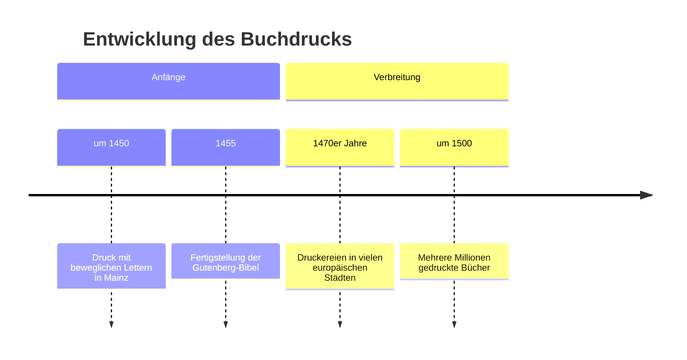
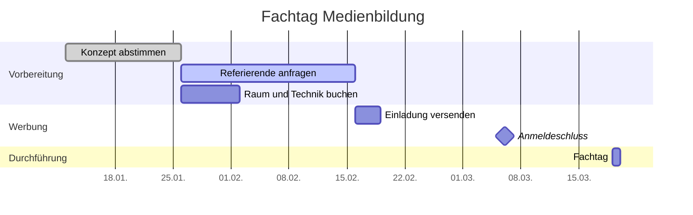

# Zeitstrahl oder Projektplan erstellen

## Was entsteht

Eine Markdown-Notiz mit einem Mermaid-Codeblock in einer von zwei Formen:

- **Zeitstrahl** (`timeline`): Ereignisse oder Epochen in ihrer Abfolge — für
  Geschichte, Biografien, Entwicklung eines Themas, Rückblick auf ein Projekt.
  Die Abstände zwischen den Einträgen sind gleich, nicht maßstabsgetreu.
- **Projektplan** (`gantt`): Arbeitspakete als Balken mit echten Daten, Dauer,
  Abhängigkeiten und Meilensteinen — für Projekte, Veranstaltungsvorbereitung,
  Schuljahresplanung.

Die App zeichnet das Diagramm im Lesen-Modus; im Markdown-Modus bleibt es
Text. Unter dem Diagramm steht derselbe Inhalt als Tabelle — für den
Ausdruck, für Screenreader und falls ein Diagramm einmal nicht gezeichnet
werden kann.

Erzeugt wird die Notiz mit `write_note`. Nicht als Word-, PowerPoint- oder
HTML-Datei: Dort wird Mermaid nicht gezeichnet.

## Schritt 1: Form wählen

- Gibt es konkrete Tagesdaten und Dauern, und geht es um Planung → `gantt`.
- Geht es um eine Abfolge (Jahre, Epochen, Stationen) ohne Tagesgenauigkeit
  → `timeline`.
- Im Zweifel `timeline` — sie verträgt ungenaue Angaben wie „um 1500“.

## Schritt 2: Inhalt beschaffen

- Lies zuerst die Quelle (Notiz, Anhang, Projektbeschreibung). Daten, Dauern
  und Reihenfolgen kommen aus der Quelle — erfinde keine Termine.
- Fehlt ein Datum, das für einen Projektplan nötig ist, lass das Arbeitspaket
  weg und nenne es unter „Offene Punkte“. Für eine `timeline` reicht eine
  Angabe wie „Frühjahr 2026“.
- Für historische Inhalte ohne Quelle im Vault: nur gesichertes Wissen, bei
  eingeschalteter Webrecherche belegt.

## Schritt 3a: Zeitstrahl (`timeline`)

- `title` mit dem Thema, dann je Zeile `Zeitpunkt : Ereignis`.
- Mehrere Ereignisse zum selben Zeitpunkt: `Zeitpunkt : Ereignis 1 : Ereignis 2`.
- Epochen gruppieren mit `section Name`, höchstens fünf Abschnitte.
- 4 bis 12 Zeitpunkte, je Zeitpunkt höchstens drei Ereignisse; Ereignistext
  höchstens 60 Zeichen.
- **Der Doppelpunkt trennt** — im Text selbst darf kein Doppelpunkt stehen.
  Uhrzeiten deshalb als „9.30 Uhr“.

## Schritt 3b: Projektplan (`gantt`)

- Kopf: `title …`, `dateFormat YYYY-MM-DD`, `axisFormat %d.%m.`
  (bei mehr als drei Monaten Laufzeit `axisFormat %m/%Y`).
- Arbeitspakete in `section`-Gruppen (Phasen oder Beteiligte), höchstens sechs
  Abschnitte, insgesamt höchstens 20 Zeilen.
- Zeile: `Name :id, Start, Dauer` — zum Beispiel
  `Raum buchen :a1, 2026-02-02, 5d`. Dauer in Tagen (`d`) oder Wochen (`w`).
- Abhängigkeit statt Startdatum: `Einladung versenden :a2, after a1, 3d`.
- Meilenstein: `Anmeldeschluss :milestone, m1, 2026-03-01, 0d`.
- Optional Status vor der ID: `done` (erledigt) oder `active` (läuft) —
  `Konzept :done, a0, 2026-01-12, 2w`. Nur, wenn die Quelle den Stand nennt.
- IDs nur aus Buchstaben und Ziffern, jede ID nur einmal.
- **Im Namen kein Doppelpunkt und kein `#`** — der Doppelpunkt trennt Name und
  Angaben.

## Regeln für beide Formen — sie verhindern Zeichenfehler

Ein Fehler im Codeblock zeigt statt des Diagramms nur eine Fehlermeldung, und
du siehst das Ergebnis nicht.

- Nur Text, Ziffern, Umlaute, Punkt, Komma, Bindestrich, Klammern.
- **Verboten**: `<`, `>`, `&` (schreibe „und“), `;`, `#` im Text,
  Anführungszeichen, Emojis, Markdown (`**`, `_`), doppelte geschweifte
  Klammern `{{…}}` (die Qualitätsprüfung hält sie für einen Platzhalter).
- Keine Farben, keine `style`-, `classDef`- oder `%%{init}`-Zeilen: Die App
  setzt das Farbschema selbst.
- Einrückung mit Leerzeichen, nicht mit Tabulatoren.

## Schritt 4: Notiz aufbauen

1. Ein bis zwei Sätze: Worum geht es, welcher Zeitraum, Quelle.
2. Der Mermaid-Codeblock (` ```mermaid ` … ` ``` `).
3. Die Tabelle mit denselben Angaben:
   - Zeitstrahl: `| Zeitpunkt | Ereignis |`
   - Projektplan: `| Arbeitspaket | Beginn | Ende | Abhängig von |`, Daten als
     TT.MM.JJJJ. Bei `after` das Ende des Vorgängers ausrechnen.
4. Optional „Offene Punkte“, wenn Daten fehlten.

Keine H1-Überschrift, die den Titel aus dem Frontmatter wiederholt.

## Abschlussnachricht

Kurz: welche Form und warum, welcher Zeitraum, wie viele Einträge, welche
Angaben gefehlt haben. Hinweis: Das Diagramm erscheint im Lesen-Modus der
Notiz.

## Beispiel Zeitstrahl (nur die Form)



## Beispiel Projektplan (nur die Form)


